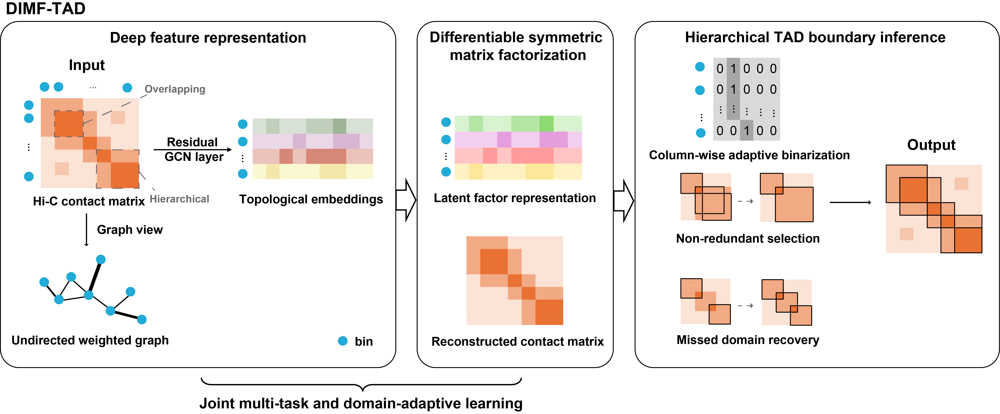

# DIMF-TAD: a deep differentiable interval-constrained matrix factorization computational framework for overlapping and multi-scale TAD identification
This is the repository for paper 'DIMF-TAD: Identifying Overlapping and Multi-Scale TADs via Deep Differentiable Interval-Constrained Matrix Factorization'.



## Functional Features

- **Hi-C Matrix Preprocessing**: Supports KR normalization, `log1p` transformation, extreme value truncation, diagonal zeroing, and normalization.
- **Deep Differentiable Matrix Factorization**: Utilizes `DynamicAI_SymNMF_Predictor` to predict interval-constrained NMF parameters, TAD representation matrices, and boundary logits.
- **Supervised Pre-training**: Can be trained based on simulated Hi-C matrices and `.domains` annotation files.
- **Global Fine-tuning**: Performs feature-level anchoring fine-tuning on target matrices to reduce model shift when adapting to new data.
- **Hierarchical TAD Calling**: Identifies parent/child TADs layer by layer, incorporating logic for overlap merging, small gap handling, and unassigned region remediation.
- **Batch Prediction and Result Export**: Supports loading multiple `.txt` or `.npz` matrices from a list of paths and outputs boundary files in TSV format.

## Requirements
Please check env/requirements.txt file. You can install environment through pip as:
```bash
pip install -r env/requirements.txt
```
It is recommended to use Python 3.9+ and prioritize running training and inference in a CUDA environment.

## Generate simulated data

In folder "example_data", except real Hi-C example, we also offer a simulated matrix and its ground truth label (.domains file). 

### Examples
1. Generate basic TAD structure (no overlap, no gaps)
```bash
python scripts/gen_sim_batch3.py --out_dir ./output --num 5 --matrix_size 100 --height 1 --min_size 10 --max_size 20 --over_up 0.0 --over_down 0.0 --noise 0.2 --gap false
```

2. Generate TAD structure with overlaps
```bash
python scripts/gen_sim_batch3.py --out_dir ./output --num 10 --matrix_size 200 --height 2 --min_size 15 --max_size 30 --over_down 0.1 --over_up 0.3 --noise 0.15 --gap false
```

3. Generate TAD structure with gaps
```bash
python scripts/gen_sim_batch3.py --out_dir ./output --num 3 --matrix_size 150 --height 1 --min_size 12 --max_size 25 --over_up 0.0 --over_down 0.0 --noise 0.1 --gap true
```
### Parameters 
#### Input Parameters
| Parameter | Corresponding Variable | Description |
|-----------|------------------------|-------------|
| `-N` | `noise_ratio` | Noise ratio (0.0-1.0) |
| `-M` | `max_vertices` | Maximum number of vertices / matrix size |
| `-m` | `min_vertices` | Minimum number of vertices / matrix size |
| `-S` | `max_tad_size` | Maximum TAD size |
| `-s` | `min_tad_size` | Minimum TAD size |
| `-e` | `intra_prob` | Probability of intra-interaction |
| `-T` | `num_matrices` | Number of matrices to generate |
| `-D` | `output_dir` | Output directory path |

#### Optional Parameters 
| Parameter | Corresponding Variable | Description |
|-----------|------------------------|-------------|
| `-h` | `height` | TAD hierarchy height |
| `-o` | `over_down` | Minimum overlap ratio |
| `-O` | `over_up` | Maximum overlap ratio |
| `-g` | `gap` | Whether to include gap regions |

## Input and Output 

The input should be symmetric Hi-C contact matrix. Example matrices are in the folder "example_data".

For simulated data, the output is a two-line txt file with the left and right boundaries. All the left boundaries are 
in the first line, and right ones in the second line.

For real Hi-C data, we output both two-line txt and eight columns .tsv files. 
An example output of the tsv file is shown below (resolution=1kb):
```
chr1	1	0       1000	chr1	44	43000	44000

chr1	9	8000	9000	chr1	16	15000	16000

chr1	17	16000	17000	chr1	44	43000	44000
```

## Usage of DIMF-TAD
The main program reads the following four path lists:

```python
PRETRAIN_PATHS_TXT = home_root + "DIMF-TAD/pretrain.txt"
VAL_PATHS_TXT = home_root + "DIMF-TAD/valid.txt"
FINETUNE_PATHS_TXT = home_root + "DIMF-TAD/finetune.txt"
TEST_PATHS_TXT = home_root + "DIMF-TAD/test.txt"
```

Each line in these list files contains one path:

- `pretrain.txt` / `valid.txt`: Each line is a dataset root directory, which should contain `matrix/` and `gt/` subdirectories.
- `finetune.txt`: Each line is a directory containing matrix files.
- `test.txt`: Each line can be either a matrix directory or a single `.txt` / `.npz` file path.

Example:

```text
/path/to/dataset_1
/path/to/dataset_2
```

## Quick Start

Currently, `dimf.py` is not a command-line argument script. You need to directly modify the configuration in `if __name__ == "__main__":` before running.

### 1. Modify Runtime Environment Configuration

Modify according to your machine:

```python
home_root = "/your/home/path/"
data_storage_root = "/your/model/storage/path/"
write_tsv = <path to save recognition results>
data_stat = <'sim' or 'real' for simulated data or real Hi-C contact data>

max_K = <max value of K>
resolution = <resolution of Hi-C contact matrix, set 25000 if simulated data>
```

For the first training, keep:

```python
MODEL_LOAD_PATH = ""
```

The program will perform pre-training and save the model to:

```python
MODEL_SAVE_PATH = data_storage_root + "trained_synmf_model.pth"
```

If you already have a pre-trained model, you can set:

```python
MODEL_LOAD_PATH = "/path/to/trained_model.pth"
```

In this case, the program will skip pre-training, directly load the model, and proceed to the subsequent fine-tuning and testing process.

### 3. Run the Program

```bash
python dimf.py
```

The program flow is:

1. Load or train the `DynamicAI_SymNMF_Predictor`;
2. Perform global fine-tuning using the target matrices in `FINETUNE_PATHS_TXT`;
3. Load the test matrices from `TEST_PATHS_TXT`;
4. Execute hierarchical TAD calling for each matrix;
5. Write the results to the directory specified by `write_tsv`.

## Output Format

`write2file()` generates a TSV file for each input matrix:

```text
<datafile_name>.tsv
```

## Contact

Feel free to open an issue in Github or contact qiusliang@upc.edu.cn if you have any problem in using.


